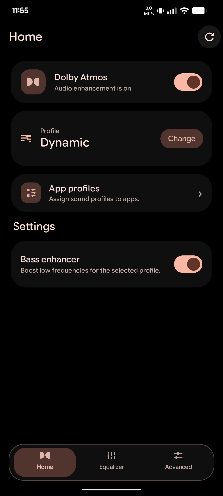
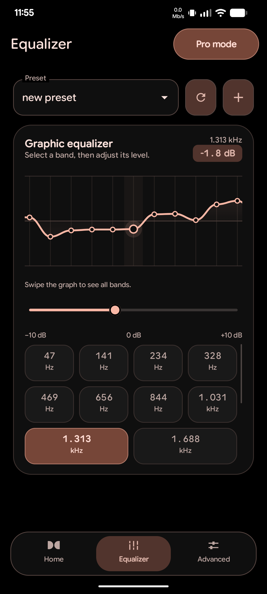
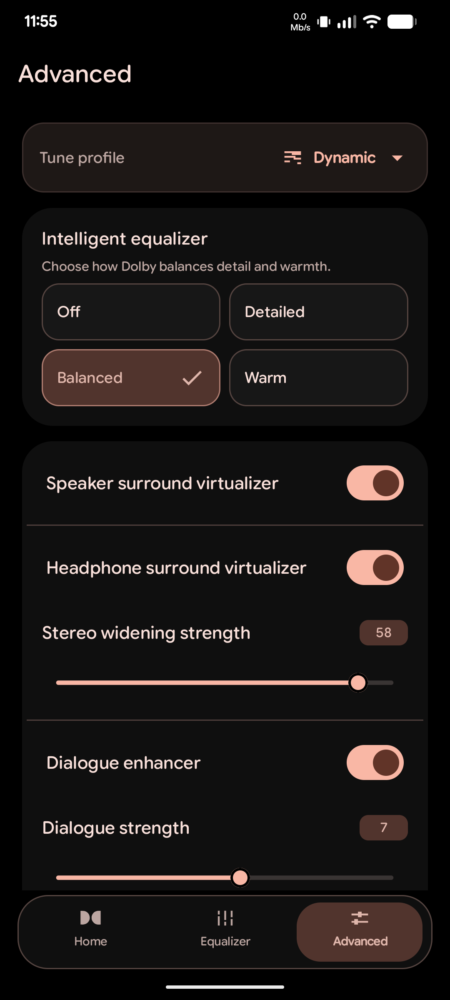
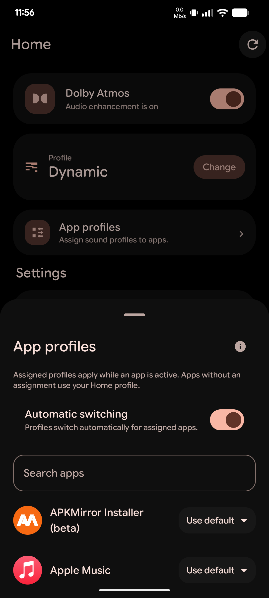

<div align="center">

# Dolby Atmos

**A simple, Material 3 Expressive audio controller for Dolby Atmos on custom ROMs.**  
Choose a listening profile, fine-tune the equalizer, customize per-profile sound effects, and automate profiles for individual apps.

<br>

<p align="center">
  
  &nbsp;
  
  &nbsp;
  
  &nbsp;
  
</p>
<p align="center"><sub><b>Home</b> &nbsp;·&nbsp; <b>Equalizer</b> &nbsp;·&nbsp; <b>Advanced Tuning</b> &nbsp;·&nbsp; <b>App Profiles</b></sub></p>

</div>

---

## Features

- **Sound Profiles** — Switch between *Dynamic*, *Movie/Video*, *Music*, *Voice*, and *Custom*, with a dedicated **Bass Enhancer** for each profile.
- **10-Band & 20-Band Equalizer** — Shape your sound with a standard **10-band EQ**, or turn on **Pro mode** for detailed **20-band** control.
- **Presets & Sharing** — Pick from 9 built-in genre presets (*Flat, Pop, Rock, Hip-Hop, Electronic, Classical, Jazz, Blues, Metal*), or save, rename, import, and export your own custom curves.
- **Per-Profile Advanced Tuning** — Configure *Intelligent EQ* (*Off, Balanced, Warm, Detailed*), *Surround Virtualizer*, *Stereo Widening*, *Dialogue Enhancer*, and *Volume Leveler* separately for each profile.
- **Per-App Profiles** — Assign specific sound profiles to individual apps and let them switch automatically as you move between apps.
- **Quick Settings Tile** — Toggle Dolby Atmos on or off directly from your status bar.

---

## Getting Started

1. Open **Dolby** and turn Dolby Atmos on.
2. Choose a profile from **Home**. *Dynamic* is the recommended starting point.
3. Open **Equalizer** to pick a preset or create your own. Turn on **Pro mode** for 20-band control.
4. Open **Advanced** and select any profile to tune its effects. *(Editing a profile here does not switch the profile currently playing).*
5. For app-specific sound, open **App profiles**, assign a profile to an app, and enable **Automatic switching** (grant *Usage Access* if Android asks for it).
6. Add the **Dolby** tile from the Quick Settings editor for quick access.

---

## ROM Integration

Add the app module to your device's product makefile:

```makefile
PRODUCT_PACKAGES += \
    XiaomiDolby
```

---

## Credits

- [Adithya R (adithya2306)](https://github.com/adithya2306)
- [Henrique Silva (jhenrique09)](https://github.com/jhenrique09)
- [Pranav Vashi (neobuddy89)](https://github.com/neobuddy89)
- [Fabian Leutenegger (33bca)](https://github.com/33bca)
- [Bruno Martins (bgcngm)](https://github.com/bgcngm)
- [Ghosuto](https://github.com/Ghosuto)
- [Nizam (ShadeDark6)](https://github.com/ShadeDark6)